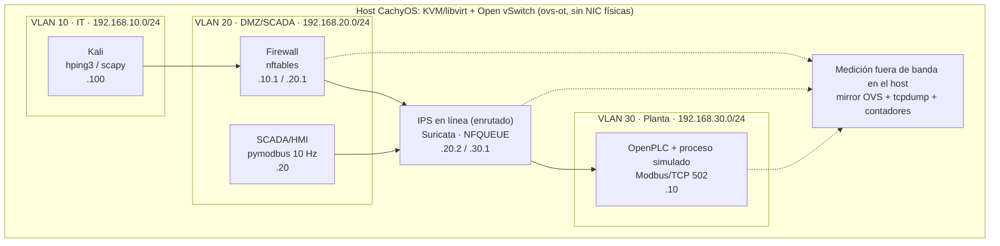

# Arquitectura del laboratorio

Un solo equipo físico: `laptop-dev` (Lenovo IdeaPad Gaming 3, Ryzen 5 6600H, 14,8 GiB RAM, CachyOS), la única plataforma del estudio (CLAUDE.md, L3). Todo es virtual y 100 % software libre. El switch Open vSwitch `ovs-ot` no tiene puertos físicos.

## Escenarios
| Id | Condición |
|---|---|
| E0 | Base, sin ataque |
| E1 | Solo firewall/VLAN (IPS solo enrutando) |
| E2 | Suricata en línea, `alert` |
| E3 | Suricata en línea, `drop` |
| E4 | (No ejecutado: Snort no se evaluó) |

Ataques: SYN flood a 502, UDP flood, ICMP flood, Modbus flood. 10 repeticiones por combinación; media, DE e IC 95 %.

## Medición
Fuera de banda en el host (mirror/taps de OVS, tcpdump) como segunda fuente frente a los contadores de Suricata, del firewall y de los puertos OVS. Guardián de RAM/swap/temperatura (ver `docs/prompts/P04_guardarrailes_ram_temp.md`).

*Diagramas del paper generados por script:* `figures/paper/a1_topology`, `a2_ips_datapath` y `a3_experiment_design` (`lab/analysis/figuras_arquitectura.py`; las VM, versiones y duraciones salen de `lab/config/`).
